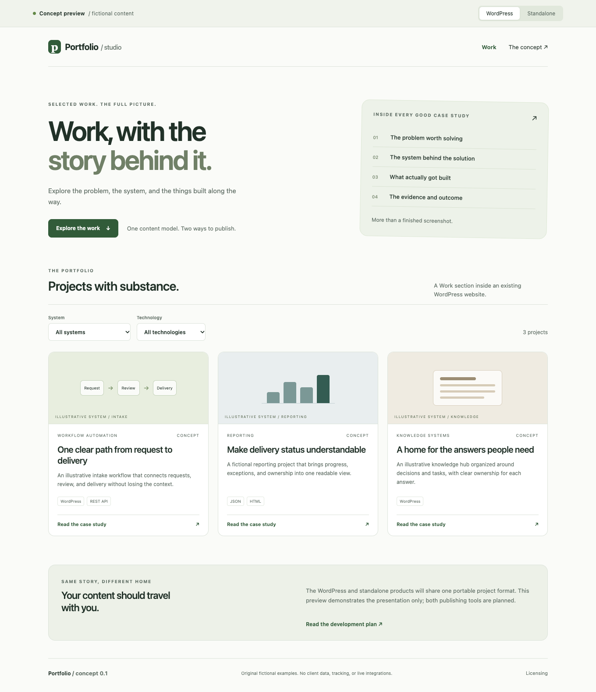

# Portfolio

### Show the work. Explain the system. Prove the outcome.

Portfolio is a product concept for turning completed work into useful, structured case studies. It is designed for consultants, agencies, developers, and people whose work needs more explanation than a screenshot.

One project can describe the problem, the system, the things built, the evidence, and the results. The same content can be published in two forms:

| Form | Best for | Publishing experience |
| --- | --- | --- |
| **Portfolio for WordPress** | People with an existing WordPress website | Install a plugin, add projects in WordPress, publish a Work section or insert a project grid into a page. |
| **Portfolio Standalone** | People who want a portfolio without WordPress | Maintain a portable content file and produce an independent static portfolio site. A visual local editor can follow later. |

Both forms follow the same [content contract](docs/architecture/content-model.md). They have separate runtimes and one portable project format.



## What exists today

This repository contains the product specification, licensing policy, content schema, original fictional examples, and a working browser concept preview. It does **not** yet contain an installable WordPress plugin, a static-site generator, or a hosted service.

Open [prototype/index.html](prototype/index.html) locally in a browser to try the preview. It shows the same fictional portfolio as a WordPress-style Work section and a standalone site, with filters, case-study detail, implementation cards, architecture, and print styling. The format switch changes the presentation; it does not install or run either product. No account, network service, tracking, or build step is required.

## Start here

- [Product concept and positioning](docs/concept.md)
- [WordPress plugin specification](docs/products/wordpress.md)
- [Standalone publisher specification](docs/products/standalone.md)
- [Other possible forms and why they come later](docs/products/extensions.md)
- [User experience and design direction](docs/experience.md)
- [MVP scope and delivery roadmap](docs/roadmap.md)

## Design and delivery

- [Shared content model](docs/architecture/content-model.md) and [JSON Schema](schemas/portfolio.schema.json)
- [Architecture and publication boundaries](docs/architecture/system.md)
- [Migration from the original Work implementation](docs/migration.md)
- [Security and privacy](SECURITY.md)
- [Release, distribution, and maintenance](docs/operations.md)
- [Checks performed and their limits](docs/verification.md)
- [Decisions and open questions](docs/decisions.md)

## Business and licensing

- [Licensing: code, content, commercial use, and trademarks](docs/business/licensing.md)
- [Commercial options and validation plan](docs/business/business-model.md)
- [Research sources and claim boundaries](docs/research/sources.md)
- [Contributing](CONTRIBUTING.md) and [third-party notices](NOTICE.md)

The current original documentation, schema, scripts, and preview are **MIT licensed**. The planned WordPress plugin runtime will use **GPL-2.0-or-later**. The independently implemented standalone publisher is planned under **MIT**. This repository does not relicense or publish the original site's code or client content. See the [license scope](docs/business/licensing.md).

## Validate this concept package

Node.js 22 or later is required for the repository checks; the browser preview itself has no Node dependency.

```sh
npm test
```

Checks cover document links, example/schema conformance, publication-safe asset paths, cross-references, prototype data parity, and JavaScript syntax. Product runtime checks will be added when those implementations exist.

Working title: **Portfolio**. Product names, WordPress.org slug availability, and trademark clearance have not been established. Current stage: **concept and prototype, 2026-10-25**.
