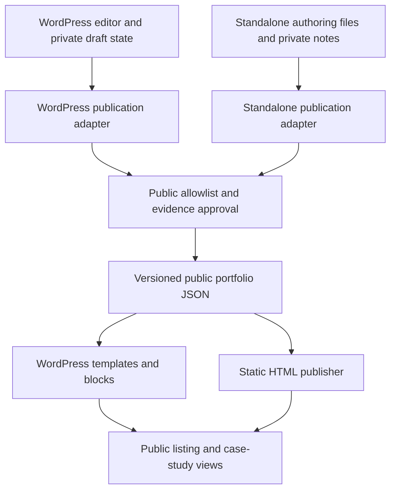

# Architecture

Status: proposed architecture. Only the schema, examples, repository validator, and browser preview are implemented.

The adapters and renderers are separate PHP/JavaScript implementations. The diagram shares a contract and publication rules, not a deployed service. No request needs to pass through a vendor account.

## Components

1. **Authoring adapter:** native WordPress persistence or local source files; draft/approval controls live here.
2. **Public projection:** explicit field allowlist, publication filtering, evidence approval, reference validation, and a version marker.
3. **Renderer:** plugin templates/blocks or static output; semantic and escaped output; presentation never decides confidentiality.
4. **Appearance configuration:** labels, colors, width, navigation, CTA, base path, and metadata. Avoid inserting site-specific configuration into portable project content.
5. **Distribution:** a plugin ZIP or static site directory, each with appropriate notices and support metadata.

## WordPress persistence proposal

Projects use posts; classifications use taxonomies; structured fields use registered post meta. Revisions should include the fields the editor promises to recover. Settings belong in the Settings API. Do not add custom tables without a demonstrated query/volume need.

The original site has a `portfolio_project` post type and `portfolio_*` meta. Clean installations should use a final unique namespace chosen after naming review. A tested legacy mode or migration adapter can adopt the existing identifiers. Do not rename existing posts or attach another registration silently. See [migration](../migration.md).

## API proposal

- Public reads: approved published projection only, bounded pagination, sanitized filters, safe error messages.
- Authoring writes: authenticated users with the target post capability, nonce checking for cookie sessions, validated payloads, escaped rendering.
- Import/export: privileged actions with limits, dry-run preview, collision policy, and a record of changes.
- No public routes that mutate business/provider systems are part of this concept.

The exact route namespace is not reserved. Avoid publishing examples that look like implemented live endpoints.

## Caching and invalidation

Invalidate project/listing projections when a project, its classifications, evidence approval, or relevant settings change. Unpublishing must evict cached public responses. Asset URLs already distributed can remain reachable; WordPress uploads and CDN caches need their own deletion/expiry process. Cache keys include locale, filters, permissions where applicable, and schema/render version. Never use a shared public cache for an authenticated draft preview.

Static publishing should create a new build directory, validate it, then atomically promote it where supported. Deployment must remove obsolete routes/assets deliberately; merely uploading new files leaves old private material accessible.

## Runtime independence

Basic authoring and rendering require no Supabase, CRM, automation account, remote fonts, or telemetry. A service integration is an optional separately reviewed feature with clear permissions, ownership, and failure behavior. Never import the original Lab loader or integrations into the public Work product by default.

## Repository growth

The current repository is a concept package. When implementation begins, add separate package directories for the WordPress plugin and standalone publisher, independent release workflows, explicit dependency licenses, and shared fixtures. A monorepo is useful if the contract stays synchronized; it should not force both runtimes to ship in the same release archive.
